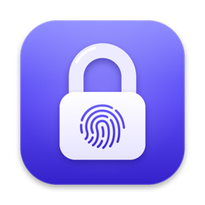
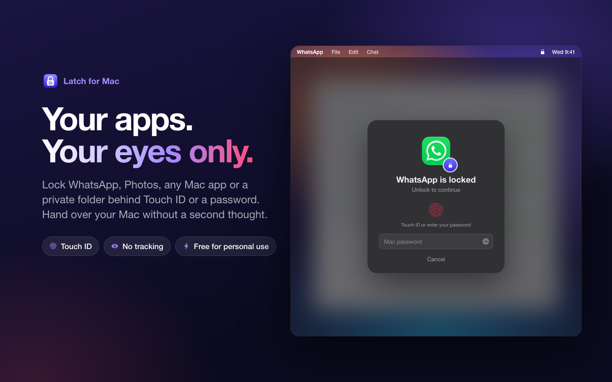
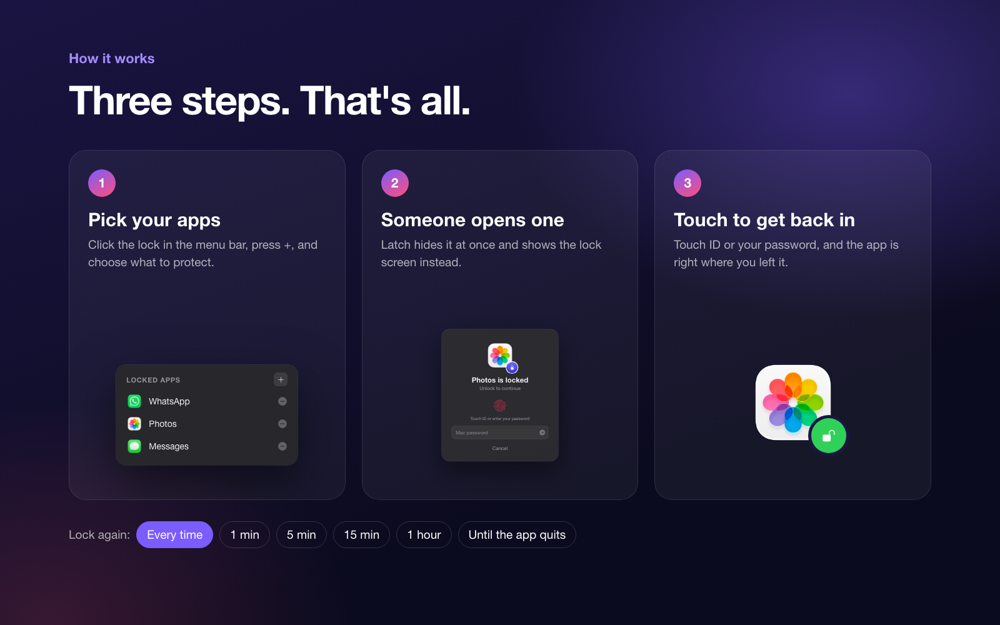
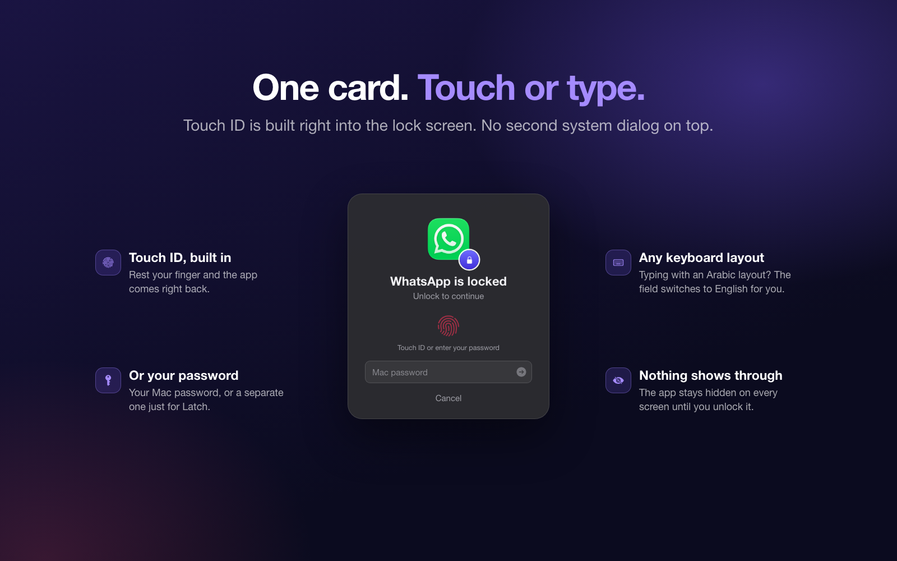
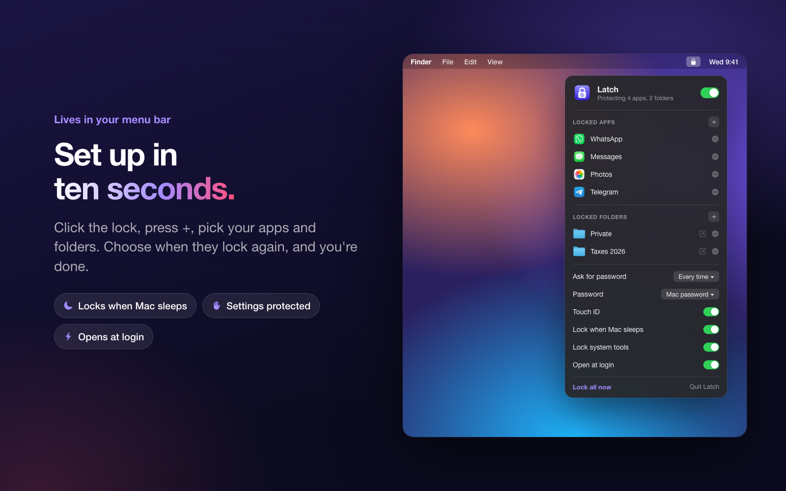
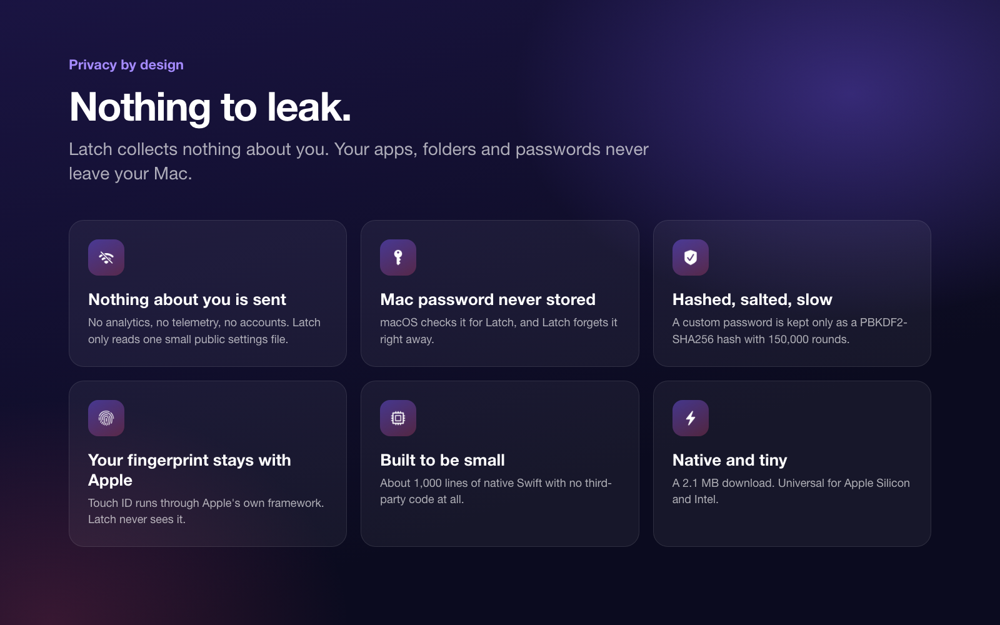
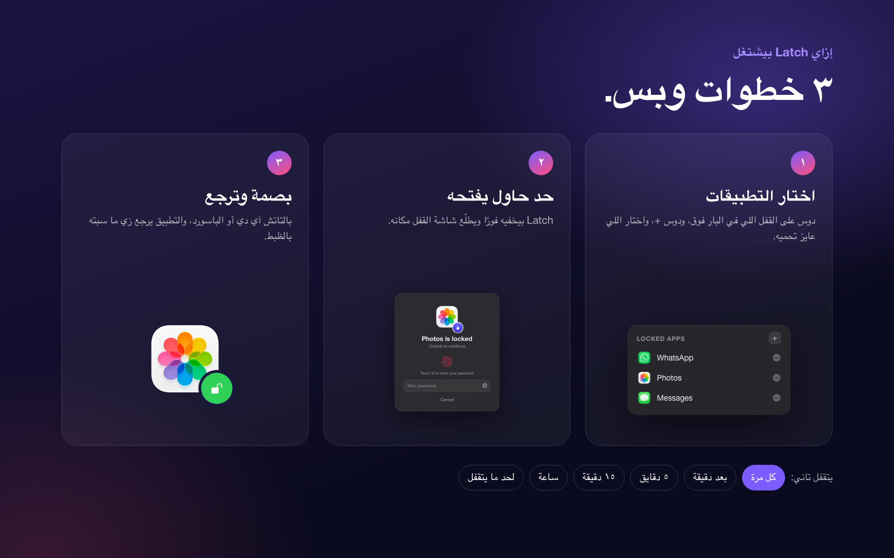

  

<h1 align="center">Latch</h1>

  <b>Lock any Mac app or folder behind Touch ID or a password.</b> 
  Lives in the menu bar. No accounts, no tracking, nothing about you leaves your Mac.

  
  
  
  
  

  <a href="https://github.com/rammahmagdy/Latch/releases/latest/download/Latch-1.6.dmg"><b>⬇ Download Latch 1.6 (DMG, 2.0 MB)</b></a>
  &nbsp;·&nbsp; <a href="#العربية">العربية</a>

Lend someone your Mac and WhatsApp, Messages, Photos, your banking app or a private folder stay closed to them. When anyone opens a locked app, Latch hides it and puts a lock screen in front of it. One card asks for Touch ID or a password, and the app comes back as soon as you're verified.

## Features

- **Lock any app.** Pick from running apps or browse `/Applications`.
- **Lock folders.** Add a folder and nothing can open it: not Finder, not other apps, not Open dialogs. Open it from Latch's menu or right-click it in Finder → **Open with Latch**, confirm with Touch ID, and it opens in Finder. It locks again after you close its window, on the same schedule as your apps. Right-click any folder → **Lock with Latch** to add it.
- **Touch ID and password in one card.** The fingerprint prompt is built into Latch's own lock screen, so no second system dialog stacks on top.
- **Your Mac password or a separate one.** Use your login password, or set a Latch-only password.
- **You choose when apps lock again:**

  | Option | Behavior |
  |---|---|
  | Every time | Asks every time you switch back to the app |
  | After 1 / 5 / 15 min / 1 hour | Stays unlocked for that long after you leave it |
  | Until the app quits | One unlock per launch |

- **Locks everything when your Mac sleeps** or the screen locks (optional).
- **"Lock all now"** in one click.
- **Settings are protected too.** Changing the app list, changing options or quitting Latch needs Touch ID or your password.
- **Hard to kill.** Force-quit Latch and it's back in under a second with everything locked again. Quit requests from Activity Monitor or scripts are refused, so only Latch's own protected menu can quit it.
- **Lock system tools (optional).** One switch also locks Activity Monitor, Terminal, iTerm, Script Editor and System Settings, the places someone would go to stop Latch.
- **Opens at login**, and runs only in the menu bar with no Dock icon.
- **Works on any keyboard layout.** The password field switches to an ASCII layout while you type, so an Arabic or other non-Latin layout won't make a correct password fail.
- **Tiny and native.** Pure SwiftUI and AppKit, about 1,000 lines, no dependencies, universal binary.

## Install

1. Download **[Latch-1.6.dmg](https://github.com/rammahmagdy/Latch/releases/latest/download/Latch-1.6.dmg)** and open it.
2. Drag **Latch** into **Applications**.
3. Open Latch. A 🔒 icon appears in the menu bar. Click it, press **+**, and pick the apps to lock.

> [!NOTE]
> **First launch:** Latch is ad-hoc signed, not notarized by Apple, so macOS will say it can't verify the developer.
> Go to **System Settings → Privacy & Security**, scroll down, and click **Open Anyway**. You only do this once.

## Privacy & security

Latch was built so it has nothing to leak.

- **Nothing about you is sent.** No analytics, no telemetry, no accounts. The only thing Latch downloads is one small public settings file ([`config.json`](https://github.com/rammahmagdy/Latch/blob/main/config.json)), a few times a day, so the developer can announce updates or retire old versions. The request carries no information about you, your apps or your folders.
- **Nothing leaves your Mac.** Settings live in the standard macOS preferences for `app.latch.Latch`, plus one launch agent file, `~/Library/LaunchAgents/app.latch.Latch.agent.plist`, that keeps Latch running.
- **Your Mac password is never stored.** Latch checks it against macOS (OpenDirectory) and then forgets it.
- **A custom password is stored only as a hash:** PBKDF2-HMAC-SHA256 with 150,000 iterations and a random 16-byte salt, compared in constant time.
- **Touch ID runs through Apple's LocalAuthentication.** Latch never sees your fingerprint data.
- **The release binary is clean.** Builds strip local paths and symbols, and the ad-hoc signature carries no personal identity.

### What Latch is and isn't

Latch is a **privacy lock** for casual access, such as a friend, a coworker or a child using your Mac. It hides app windows behind authentication and removes all permissions from locked folders. It does **not encrypt** anything.

**Tamper resistance.** macOS lets any user end their own apps, so Latch can't make itself unkillable without running as root. Instead it makes killing pointless:

| Attempt | What happens |
|---|---|
| Force Quit (⌥⌘⎋) or Activity Monitor → Force Quit | The watchdog relaunches Latch in under a second, and every locked app is hidden again |
| Activity Monitor → Quit, AppleScript `quit`, `kill` | Refused, or restarted the same way |
| Stopping the agent from Terminal or turning Latch off in System Settings | Turn on **Lock system tools** so those apps need your password first |
| Logging out, restarting, shutting down | Always allowed |

Locked folders rely on file permissions, which the folder's owner can change back, for example from Terminal. Turn on **Lock system tools** to keep Terminal locked too. Latch refuses to lock folders that macOS needs, such as your home folder, Desktop, Documents or Library themselves; lock a folder inside them instead.

Someone who already knows your password, or who boots into another account, can still get past it. For real protection of data at rest, use FileVault and a separate macOS user account for guests.

## FAQ

**Why "Latch"?** A latch is the small bolt that keeps a door shut: simple, light, always there. That's the idea. It isn't a vault, just a quick lock that keeps people out of what isn't theirs.

**Does it work with Apple Watch unlock?** Not yet. Touch ID and passwords are supported.

**How do I update?** Quit Latch from its menu, replace `Latch.app` in Applications, and open it. Your settings and locked apps carry over.

**I don't see Open with Latch when I right-click a folder.** It's at the bottom of the menu, or under **Quick Actions** or **Services**. If it's missing, open Latch once, then check System Settings → Keyboard → Keyboard Shortcuts → Services → Files and Folders and turn on the two Latch items.

**A folder is stuck locked. How do I get in?** Open it from Latch's menu. If Latch is gone, run `chmod u+rwx "/path/to/folder"` in Terminal, or use Finder → Get Info → Sharing & Permissions.

**How do I uninstall?** In Latch's menu remove your locked folders (this gives them their permissions back) and turn off **Open at login** (this removes the launch agent), quit Latch, then delete `/Applications/Latch.app`. To remove its settings too, run `defaults delete app.latch.Latch`.

## Feedback

Bug reports and ideas are welcome in [Issues](https://github.com/rammahmagdy/Latch/issues). Latch may not be modified or redistributed without permission.

## License

**Latch is free for personal use. The source code is private.** © 2026 rammahmagdy. All rights reserved, except as granted by the [PolyForm Strict License 1.0.0](LICENSE).

| Allowed | Not allowed without written permission |
|---|---|
| Downloading and using Latch for personal, noncommercial purposes | Any commercial use |
| | Copying any part of Latch |
| | Redistributing, reuploading or selling Latch |
| | Modifying, decompiling or reverse-engineering it, or making new works based on it |

For any use the license doesn't cover, ask first in [Issues](https://github.com/rammahmagdy/Latch/issues).

---

## العربية

**Latch** أبلكيشن صغير للماك بيقفل أي تطبيق أو فولدر بالتاتش آي دي أو بباسورد. بيشتغل من البار اللي فوق بس، ومن غير حسابات ولا تتبّع، ومفيش أي حاجة عنك بتخرج من جهازك.

### المميزات
- تقفل أي تطبيق: واتساب، الرسايل، الصور، البنك… أي حاجة.
- **تقفل فولدرات:** الفولدر المقفول محدش يقدر يفتحه، لا من الـFinder ولا من أي تطبيق تاني. تفتحه من قايمة Latch، أو كليك يمين عليه في الـFinder واختار **Open with Latch**، وبعد البصمة بيفتح على طول. ولما تقفل الشباك بتاعه بيتقفل تاني لوحده. وعلشان تضيف فولدر: كليك يمين عليه واختار **Lock with Latch**.
- **كارت واحد** فيه التاتش آي دي والباسورد مع بعض، من غير ما تطلعلك رسالة تانية من السيستم.
- تستخدم باسورد الماك نفسه أو باسورد مخصوص لـLatch.
- تختار إمتى التطبيق يتقفل تاني: كل مرة، أو بعد ١ / ٥ / ١٥ دقيقة أو ساعة، أو لحد ما التطبيق يتقفل.
- يقفل كل حاجة لما الماك ينام أو الشاشة تتقفل.
- الإعدادات نفسها محمية، ومحدش يقدر يغيّرها أو يقفل Latch من غير ما يتأكد إنه أنت.
- **صعب يتقفل غصب عنك:** لو حد عمل Force Quit لـLatch، بيرجع يشتغل في أقل من ثانية ويقفل كل حاجة تاني. وأي محاولة قفل من Activity Monitor أو سكريبت بيرفضها.
- اختيار **Lock system tools** بيقفل كمان Activity Monitor والـTerminal والـSystem Settings، اللي ممكن حد يستخدمها علشان يوقف Latch.
- بيفتح لوحده مع الماك.
- بيشتغل حتى لو الكيبورد عربي، لأن خانة الباسورد بتحوّل للإنجليزي وأنت بتكتب.

### التثبيت
١. نزّل **[Latch-1.6.dmg](https://github.com/rammahmagdy/Latch/releases/latest/download/Latch-1.6.dmg)** وافتحه. 
٢. اسحب Latch لفولدر Applications. 
٣. افتحه، هتلاقي أيقونة 🔒 فوق. دوس عليها، ودوس +، واختار التطبيقات.

> **أول مرة بس:** الماك هيقول إنه مش قادر يتأكد من المطوّر، لأن التطبيق مش موثّق من أبل.
> روح **System Settings ← Privacy & Security**، انزل لتحت، ودوس **Open Anyway**.

### الخصوصية
- مفيش أي بيانات عنك بتتبعت. الحاجة الوحيدة اللي Latch بينزّلها هي ملف إعدادات صغير وعام من جيت هاب، علشان المطوّر يقدر يعلن عن التحديثات.
- باسورد الماك مش بيتحفظ أبدًا، الماك نفسه هو اللي بيتأكد منه.
- الباسورد المخصوص بيتحفظ كـhash مشفّر (PBKDF2-SHA256، ١٥٠ ألف تكرار).
- بصمتك بيتعامل معاها نظام أبل، وLatch عمره ما بيشوفها.

**ليه اسمه Latch؟** الـLatch هو الترباس الصغير اللي بيقفل الباب: بسيط وخفيف وموجود على طول. ده بالظبط التطبيق: مش خزنة، لكنه قفل سريع يمنع أي حد من اللي مش بتاعه.

### الترخيص
Latch مجاني للاستخدام الشخصي، والكود بتاعه مش متاح للعامة. كل الحقوق محفوظة © 2026 rammahmagdy بموجب [ترخيص PolyForm Strict 1.0.0](LICENSE).
- مسموح: تنزّله وتستخدمه استخدام شخصي غير تجاري.
- ممنوع من غير إذن مكتوب: أي استخدام تجاري، أو نسخ أي جزء منه، أو إعادة نشره أو بيعه، أو التعديل عليه أو فك تشفيره.

